<div align="center">

# 🕵️ Wireshark SOC Lab: Finding a Hidden Note in an Intranet Page with Follow TCP Stream (Part 2)

**Reading the raw HTTP traffic of a company intranet to find a secret that a browser never shows**
</div>

<p align="center">
  
  
  
  
  
</p>

---

## 📌 Project Overview

This is Lab 5 of the Networkwalks Wireshark SOC labs, and the second one on **Follow TCP Stream**. The scenario:

> *A staff member browsed the company intranet. An admin thinks someone left a secret inside one of the web pages. Capture the traffic and use Follow TCP Stream to find the hidden text.*

The lab runs in the browser. It gives you a Windows 11 PC with Wireshark installed, and you complete **10 tasks** (10 marks each). I followed the lab's written instructions for each task. My final score was **100/100**, and since every task scored full marks, I used no hints (each hint costs 10% of a task's marks).

All the names, codes and IP addresses in this lab are simulated lab data.

| 🔎 Item           | ✅ Result                                                        |
| ----------------- | ---------------------------------------------------------------- |
| Page with the secret | `/staff.html` (TCP stream 7)                                  |
| Where it was hidden | An HTML comment, sent from the server to the client           |
| Code word         | `Falcon-9921`                                                    |
| Backup server     | `192.168.10.77`                                                  |
| Downloaded file   | `report.txt`, prepared by Nadia                                  |

---

## 🎯 Objectives

- Capture traffic in Wireshark and read the total packet count.
- Find the web pages the staff member opened.
- Use **Follow → TCP Stream** to read the full HTTP request and response of a page.
- Find a note that a browser hides but the network carries.
- Tell the client's data from the server's data in the Follow window.
- Find a downloaded file and read its contents by following its stream.

---

## 🛡️ Why This Matters for Security

When a website is served over plain HTTP, everything in the page travels across the network readable, including parts a visitor never sees on screen. A SOC analyst who follows the stream sees what the network sees.

This lab shows how a developer's note, left in a page by mistake, can leak an internal server address and an access code to anyone who can capture the traffic.

> ⚠️ **Important:** Only capture and read web traffic on networks and devices you own or have explicit permission to monitor. This lab runs in a simulated environment provided by Networkwalks.

---

## ⚙️ Lab Configuration

| 🧩 Component        | ⚙️ Configuration                                                               |
| ------------------- | ------------------------------------------------------------------------------ |
| 🌐 Platform         | Networkwalks online lab (`networkwalks.com/wireshark-lab5`)                    |
| 🖥️ Analyst PC       | Windows 11 PC in the lab (user `Student`)                                      |
| 🦈 Tool             | Wireshark, capturing on the `WiFi` interface                                   |
| 📦 Capture Size     | 282 packets                                                                    |
| 🧭 Capture Point    | Switch with a SPAN port mirroring traffic to the analyst PC                    |
| 🧑‍💻 SOC Analyst      | `192.168.10.10`                                                                |
| 💻 Staff PC         | `192.168.10.45`                                                                |
| 🗄️ Intranet Server  | `192.168.10.20` (host name `intranet.company.local`)                           |
| 🏆 Scoring          | 10 tasks × 10 marks; each hint costs 10% of that task's marks                  |

### Topology (from the lab brief)

```text
SOC Analyst (Wireshark)            Staff PC
 192.168.10.10                    192.168.10.45
        │                               │
        └──────────── Switch ───────────┘
                  (SPAN: packet capture point)
                          │
              Other hosts, Intranet Server 192.168.10.20
```

---

# 🪜 Lab Procedure

## Step 1. Capture the Traffic (Task 1)

I signed in to the Windows PC, opened Wireshark, and double-clicked the `WiFi` interface to start the capture. The status bar shows **Packets: 282**.

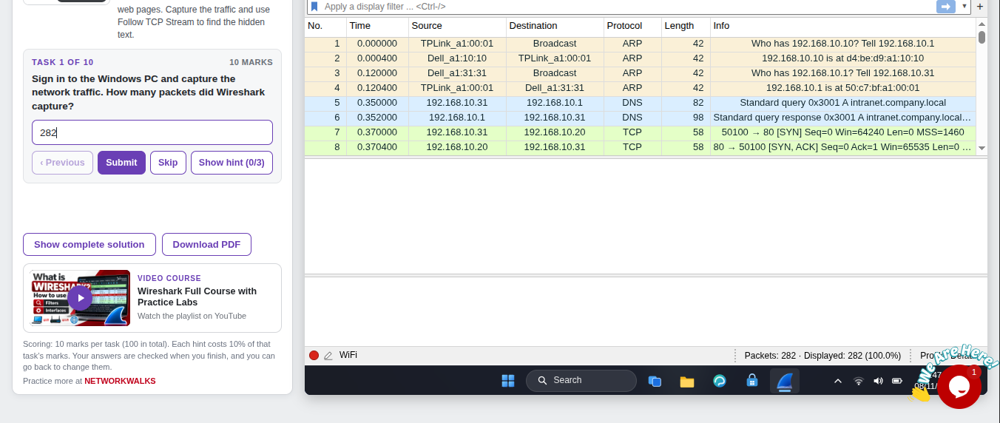

**Answer: 282.**

---

## Step 2. Find the Page with the Hidden Note (Task 2)

The staff member opened five pages on the intranet. Following the lab's method, I looked at the web requests (HTTP), right-clicked a `GET` packet and chose **Follow → TCP Stream**. The Follow window shows the request in red and the server's response in blue.

For the page about staff, `/staff.html`, the response contains a line that is not part of the normal page:

```html
<html><body><h1>Staff directory</h1><p>Contact IT for changes.</p>
<!-- IT note: backup server is 192.168.10.77, access code Falcon-9921. Remove before publishing. -->
</body></html>
```

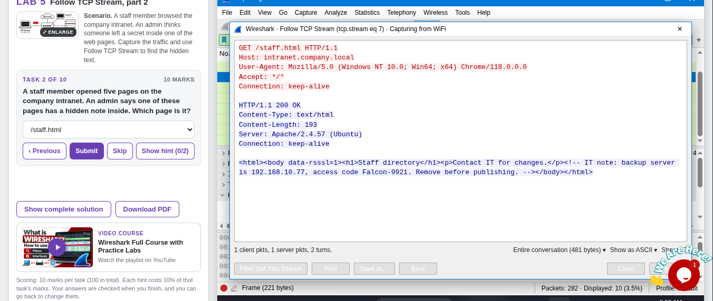

**Answer: `/staff.html`.**

---

## Step 3. Find Where the Note Is Hidden (Task 3)

The note sits between `<!--` and `-->`. That is an **HTML comment**. A browser does not show it on the page, but it is still part of the response the server sends, so Wireshark shows it.

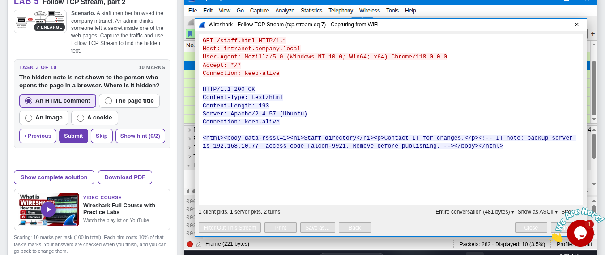

**Answer: An HTML comment.**

---

## Step 4. Find the Stream Number (Task 4)

The bottom of the Follow window shows **Stream 7**, and the window title shows `tcp.stream eq 7`. The same stream in the packet list shows the whole exchange: the TCP handshake, the `GET /staff.html`, the `200 OK` reply, and the connection closing.


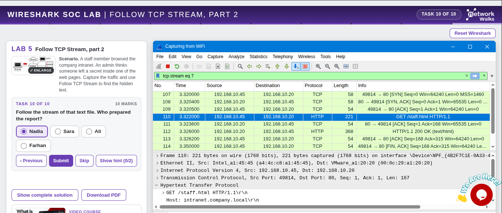

**Answer: 7.**

---

## Step 5. Read the Code Word and the Backup Server (Tasks 5 and 6)

Reading the comment:

- **Task 5:** the code word comes after "access code": **`Falcon-9921`**.
- **Task 6:** the backup server comes after "backup server is": **`192.168.10.77`**.

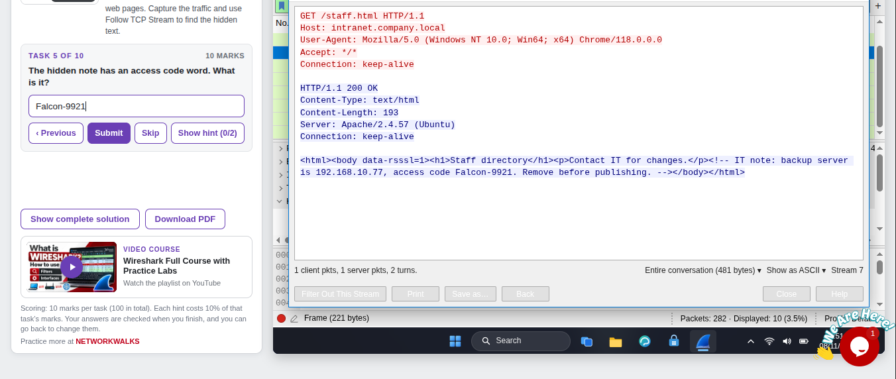

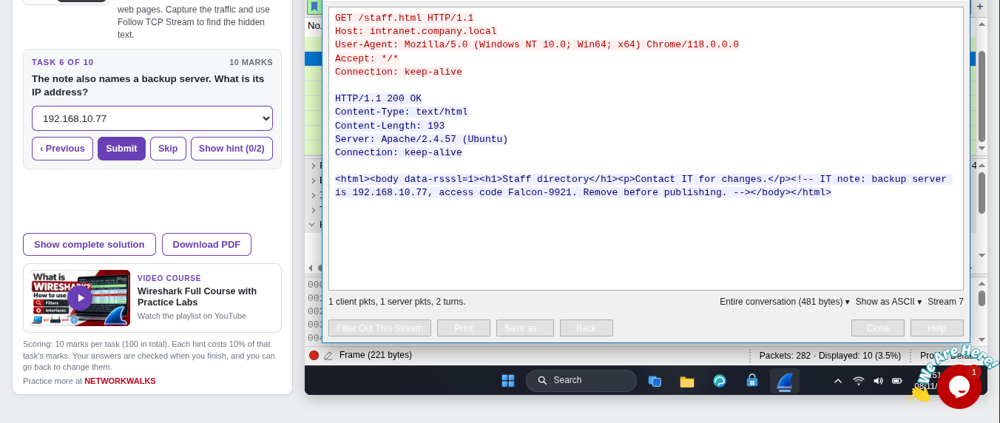

---

## Step 6. Work Out Which Way the Note Travelled (Task 7)

In the Follow window, red text is sent by the client (the PC that asked for the page) and blue text is sent by the server. The hidden note is in the **blue** text, so it travelled **from the server to the client**.

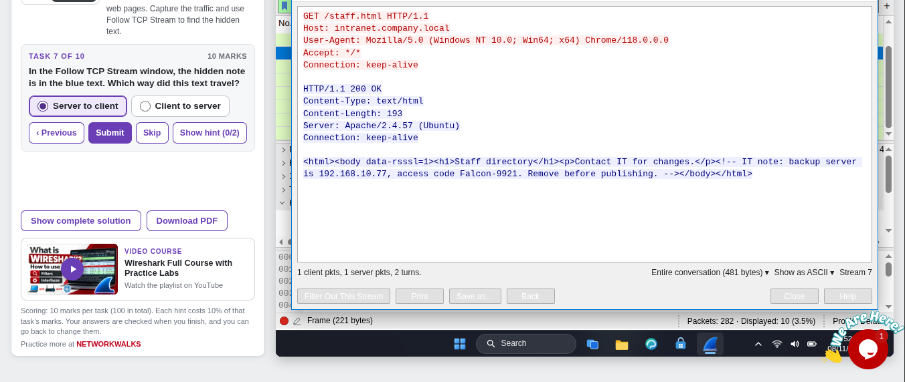

**Answer: Server to client.**

---

## Step 7. Read the Status Code (Task 8)

The first blue line in the Follow window is `HTTP/1.1 200 OK`. The status code is **200**.


**Answer: 200.**

---

## Step 8. Find the Downloaded File (Task 9)

The staff member also downloaded a plain text file from the `/download/` folder. I filtered on the request address:

```text
http.request.uri contains "download"
```

One packet matches (packet 168): `GET /download/report.txt HTTP/1.1`, from `192.168.10.45` to `192.168.10.20`.

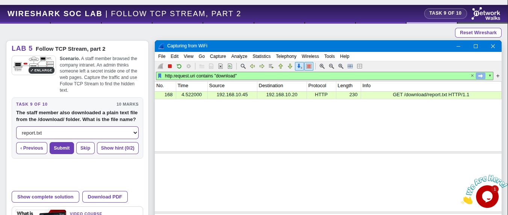

**Answer: `report.txt`.**

---

## Step 9. Find Who Prepared the Report (Task 10)

To answer this, I had to follow the stream of the `report.txt` download and read the line that starts with "Prepared by". The text says **Prepared by: Nadia**.

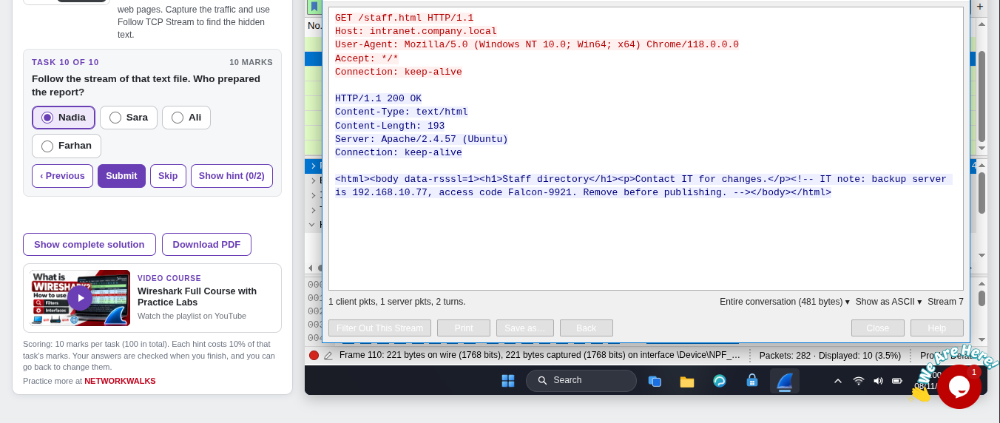

**Answer: Nadia.** (See *Challenges Encountered* for how I got the Follow window onto the right stream.)

---

## Step 10. Result

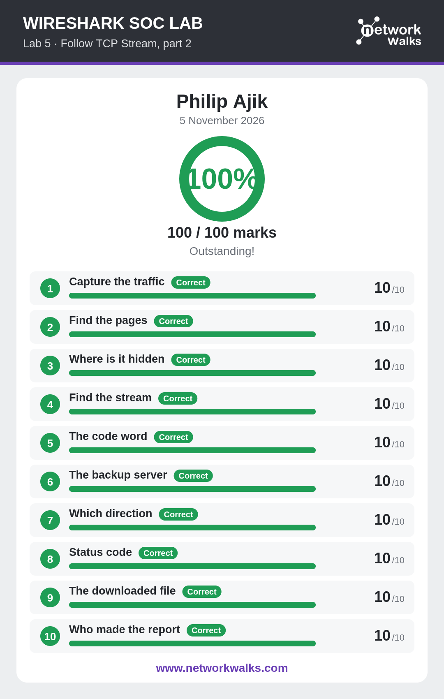

---

# 📊 Results

| #  | 🎯 Task               | ✅ Answer                  | 🔎 How I Found It                                              | 🏆 Result |
| -- | --------------------- | -------------------------- | -------------------------------------------------------------- | --------- |
| 1  | Capture the traffic   | `282` packets              | Status bar after starting the capture                          | ✅ 10/10  |
| 2  | Find the pages        | `/staff.html`              | Follow → TCP Stream on the page about staff                    | ✅ 10/10  |
| 3  | Where is it hidden    | An HTML comment            | Note sits between `<!--` and `-->`                             | ✅ 10/10  |
| 4  | Find the stream       | `7`                        | Title and bottom bar of the Follow window                      | ✅ 10/10  |
| 5  | The code word         | `Falcon-9921`              | Text after "access code" in the comment                        | ✅ 10/10  |
| 6  | The backup server     | `192.168.10.77`            | Text after "backup server is" in the comment                   | ✅ 10/10  |
| 7  | Which direction       | Server to client           | Note is in the blue text, which the server sends              | ✅ 10/10  |
| 8  | Status code           | `200`                      | First blue line: `HTTP/1.1 200 OK`                            | ✅ 10/10  |
| 9  | The downloaded file   | `report.txt`               | `http.request.uri contains "download"`                         | ✅ 10/10  |
| 10 | Who made the report   | `Nadia`                    | "Prepared by" line in the `report.txt` stream\*                | ✅ 10/10  |

\* I don't have a screenshot of the `report.txt` stream window itself. The answer matches the lab's answer key, and my result card marks Task 10 as correct.

### Timeline of the /staff.html Request (stream 7)

| ⏱️ Time (s) | 📦 Packet | 🔄 What happened                                                           |
| ----------- | --------- | -------------------------------------------------------------------------- |
| 3.3200      | 107       | `192.168.10.45` sends a SYN to port 80 on the intranet server              |
| 3.3204      | 108       | Server replies `SYN, ACK`                                                  |
| 3.3205      | 109       | Client replies `ACK`: the connection is open                               |
| 3.3220      | 110       | Client sends `GET /staff.html HTTP/1.1`                                    |
| 3.3260      | 112       | Server replies `HTTP/1.1 200 OK (text/html)` with the hidden comment inside |
| 3.3500      | 114       | Client sends `FIN, ACK`: the connection is closing                         |

The `report.txt` request (packet 168) came later, at 4.522 s.

---

# 🔭 Observations Beyond the Task Questions

These are things I saw in the screenshots while documenting. The lab does not ask for them.

1. **"Hidden" only means "not displayed".** The browser skips the comment when drawing the page, but the server still sends it. Anyone who captures the traffic can read it, and so can anyone who views the page source.
2. **The note says "Remove before publishing".** It was a note for IT that was left in a page by mistake, and it contained a server address and an access code.
3. **The page was sent over plain HTTP on port 80.** Nothing in the exchange was encrypted, which is why the whole page appears readable in Wireshark.
4. **The whole page fetch is tiny.** The Follow window shows 1 client packet, 1 server packet and 2 turns, 481 bytes in total: 167 bytes from the client and 314 from the server, whose `Content-Length` is 193.
5. **The headers tell an observer about the systems.** The response says `Server: Apache/2.4.57 (Ubuntu)`, and the request says `User-Agent: Mozilla/5.0 (Windows NT 10.0; Win64; x64) Chrome/118.0.0.0`. Together they reveal the server software and the staff PC's browser and operating system.
6. **The browsing order is visible.** `/staff.html` was fetched at about 3.3 s and `report.txt` at about 4.5 s.

---

# 🐞 Challenges Encountered

I had no technical difficulties with Wireshark or the lab environment. The one place I got stuck was **Task 10**.

* **Issue:** the Follow TCP Stream window kept showing stream 7 (`/staff.html`), but Task 10 needed a different stream, the one carrying `report.txt`. I wasn't sure how to move the Follow window to another stream.
* **Research:** I asked an AI assistant (Gemini) how to change the stream. It gave two methods:
  1. **Change the filter:** edit it to `tcp.stream eq N` (for example 0, 1, 2), press Enter, then right-click a packet and choose Follow → TCP Stream.
  2. **Search for the file:** filter on `http.request`, find the request for the `.txt` file, right-click it and choose Follow → TCP Stream.

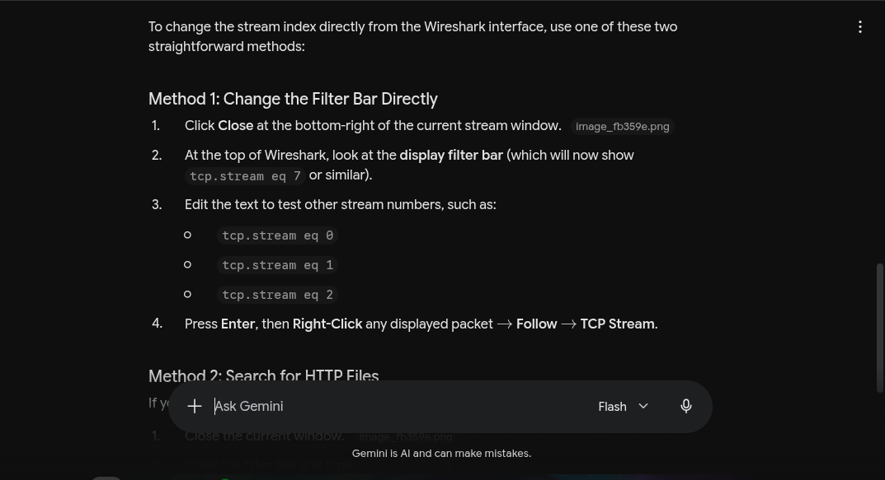

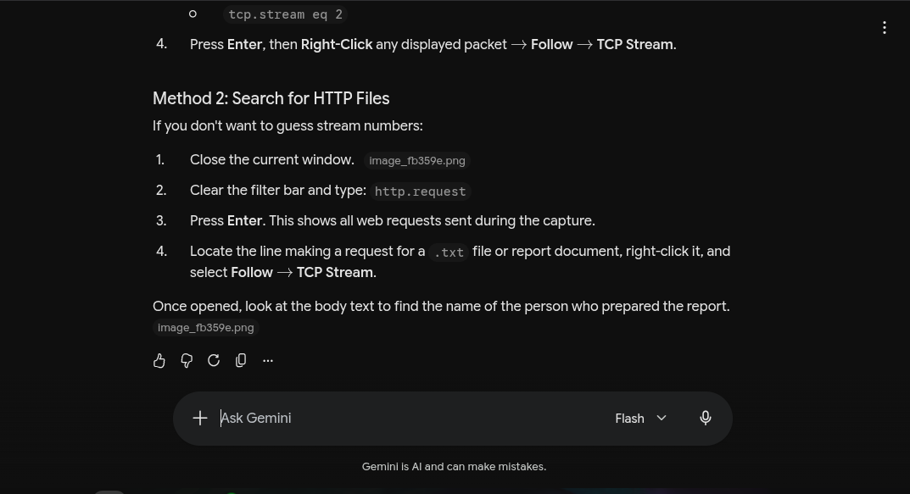

* **Cross-check:** both methods are standard Wireshark steps, and they match the lab's own hint: "Change the stream number at the bottom to see the next page."
* **Resolution:** Task 10 scored 10/10.
* **What I'll do differently:** the Task 9 filter had already put the `report.txt` request (packet 168) on screen. Right-clicking that packet and choosing Follow → TCP Stream goes straight to the right stream without guessing numbers.

---

# 💡 Key Learnings

1. **Follow TCP Stream shows the whole HTTP exchange:** the request, the response headers and the page source, including parts a browser never displays.
2. **An HTML comment is not a safe place for secrets:** it is hidden from the screen, not from the network.
3. **Red is the client and blue is the server:** that told me the note travelled server to client. The same convention came up in Lab 4, and this time I read it correctly.
4. **Stream numbers identify conversations:** I can jump between them with `tcp.stream eq N` or the stream number at the bottom of the Follow window.
5. **A targeted filter finds things fast:** `http.request.uri contains "download"` went straight to the one download.
6. **Plain HTTP exposes everything:** pages should be served over HTTPS, and internal notes, addresses and codes should be removed before a page is published.
7. **Headers leak information:** server software and browser details are visible to anyone watching the traffic.
8. **When stuck, research and then document it:** looking up how to switch streams taught me something I will reuse.

---

# 🔐 Security & Ethical Use

This lab is for education only and ran in a simulated environment provided by Networkwalks. The code word and addresses in this document are lab data. Only capture and read network traffic on networks and devices you own or have permission to monitor.

---

# 🔗 Tools & Resources

- **Online lab:** [https://networkwalks.com/wireshark-lab5/](https://networkwalks.com/wireshark-lab5/)
- **Wireshark:** [https://www.wireshark.org/download.html](https://www.wireshark.org/download.html)
- **NetworkWalks:** [https://networkwalks.com](https://networkwalks.com)

---

# 👤 Author

**Philip Ajik**  
Cybersecurity Student (Batch B082) — Networkwalks Academy  
LinkedIn: [https://www.linkedin.com/in/philip-ajik-a22944384](https://www.linkedin.com/in/philip-ajik-a22944384)

---

## 📌 Project Information

**Program Name:** Cybersecurity at Networkwalks | **Task:** Wireshark SOC Lab 5 | **Project:** Follow TCP Stream, Part 2 | **Repository:** GitHub
